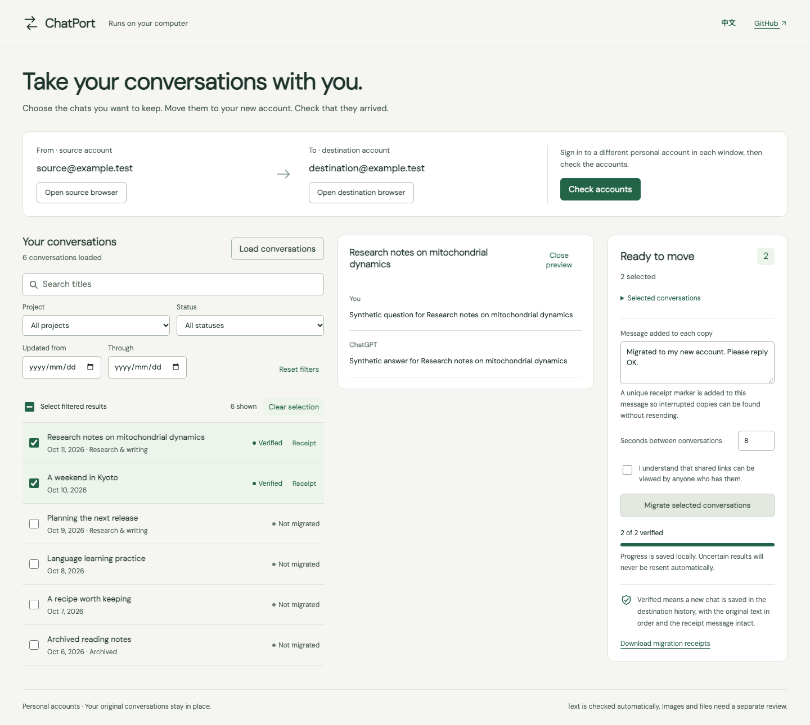

# ChatPort

**Pick your ChatGPT conversations. Copy them to your new account. Verify that they arrived.**

[简体中文](README.zh-CN.md) · [Download the Chrome extension](https://github.com/stors789/chatgpt-migrator/releases/latest)

ChatPort is a Chrome extension for moving selected conversations between your own **personal ChatGPT accounts** through shared links. It uses your ordinary browser sessions: the source account in a regular window, the destination in an incognito window. **No terminal, Node.js, API key, cookie copying or automation browser is needed to use it.**



_The screenshot uses synthetic accounts and conversations. This is an unofficial community tool._

## Install

1. Download `chatport-extension-v0.2.1.zip` from [Releases](https://github.com/stors789/chatgpt-migrator/releases/latest), then unzip it into a permanent folder.
2. Open `chrome://extensions` in Chrome, enable **Developer mode**, click **Load unpacked**, and select the unzipped folder containing `manifest.json`.
3. Open ChatPort's **Details** and enable **Allow in incognito**. This lets the extension operate the destination account while keeping its login session separate.
4. Pin ChatPort in Chrome's extension menu and click its icon to open the workspace.

This release is loaded locally; it is not listed in the Chrome Web Store. Keep the unzipped folder in place. To update, replace its files in that same folder and click Reload in Chrome's Extensions page. Download receipts before uninstalling: removing an extension removes its local records.

## Move conversations

1. Click **Open source · regular window**. Sign in to the source ChatGPT account normally if needed.
2. Click **Open destination · incognito**. Sign in to a different ChatGPT account normally. Choose **Personal** in both windows and keep them open.
3. Return to ChatPort, click **Check accounts**, and confirm the two displayed accounts. Click **Load conversations**.
4. Search by title, filter by date, named project or migration status, preview and select chats. Your selection survives filter changes.
5. Review the receipt message and delay. Confirm that selected chats may be shared, then start. Keep the ChatPort workspace open while the batch runs. **Pause after current conversation** stops safely between chats.
6. Open receipts to inspect results. For uncertain copies, use **Check again without resending**; optionally provide a destination `https://chatgpt.com/c/...` URL.
7. Download receipts. After checking the copies, you can revoke source links in ChatGPT **Settings → Data controls → Shared links**. Source conversations remain in place.

Closing or reloading the workspace interrupts its runner. Saved receiving attempts become **Needs checking** on reopening, and are never resent automatically. On a browser restart, reopen both account windows and sign in to the destination again: incognito authentication is not retained after all incognito windows close. Receipts remain in the extension's local storage.

## Why the extension?

Google can reject sign-in from [browsers controlled through software automation](https://support.google.com/accounts/answer/7675428). ChatPort 0.2 uses Chrome's extension APIs on normal user-opened sessions. It does not automate Google authentication, hide automation flags, use stealth plugins or solve verification challenges. Sign in using the method your ChatGPT account normally uses.

## What counts as verified?

Before sharing, ChatPort fingerprints the **visible user and assistant text on the active branch** with SHA-256. It continues the shared chat and adds your message with a unique `[ChatPort:…]` marker. All of these must hold:

- A destination chat ID exists and differs from the source ID.
- It appears in the destination account's saved, unarchived history.
- Reading it back returns that ID and an editable conversation.
- Exactly one user message matches the complete receipt marker.
- Every original visible text message before the marker has the same role, order, content and count.

A composer, new URL, incomplete history, wrong account or missing marker cannot produce success. Limited persistence checks do not resend messages. Both account identities are rechecked during the run.

Images, uploads, generated files, tool results and alternative historical branches need separate review. Media-bearing messages are flagged. Project chats arrive as ordinary chats; project files, settings and organization are not recreated. Subscriptions, memories, custom GPTs and account settings are outside scope. Business, Enterprise and Edu cross-workspace transfers are not supported.

## Permissions and privacy

- `https://chatgpt.com/*`: read the selected catalog and chats, create share links and continue copies in the bound account tabs.
- `scripting`: run those operations inside the bound ChatGPT tabs.
- `storage`: save receipt records and bound tab IDs locally. No browser sync storage is used.
- **Allow in incognito**: access the destination session. The workspace and receipts remain in the regular extension context.

There is no local HTTP server, hosted backend, analytics, cookie permission, debugger permission or Google-site access. Authentication tokens are used only inside their ChatGPT tab and are not returned to the workspace. Records contain chat titles, share URLs, fingerprints and receipt messages; original message transcripts are not persisted. Preview text exists in workspace memory while displayed. Downloaded receipts may contain sensitive titles and share links: keep them private.

## Development

Node.js 22+ is required only to build and test source code.

```sh
npm ci
npm run build
npm run check
npm test
npm run browser:install
npm run test:e2e
```

Load the generated `dist/` folder as the extension. Runtime code uses platform APIs; Playwright is a development-only test dependency.

Unit tests cover strict verification, account changes, pause, concurrency and interrupted attempts. Browser tests load the actual Manifest V3 extension in Chromium and use **synthetic ChatGPT responses** in real regular/incognito contexts. They do not log into real accounts or establish future compatibility with ChatGPT's unofficial web APIs. A real two-account smoke test is still required before migrating important chats.

The older Node/Playwright implementation is preserved in the `v0.1.0` Git tag. Version 0.2 does not read its `~/.chatport` directory. The receipt format and SHA-256 verification rules are retained.

MIT licensed. See [Third-party notices](THIRD_PARTY_NOTICES.md) and [Security](SECURITY.md). Contributions should keep selection easy and verification strict.
